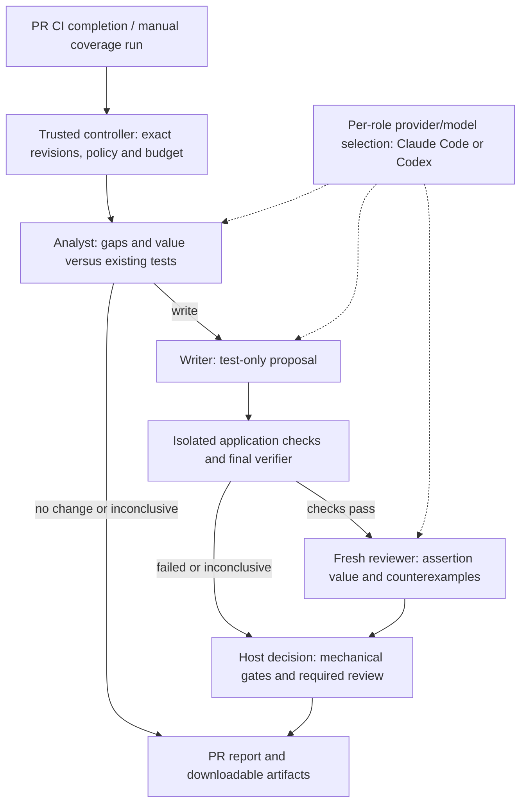

# Cloudfide unit-test agent

The solution analyzes missing unit-test behavior, proposes test-only patches and verifies them in GitHub Actions before publishing a PR report and downloadable patch. Analyst, writer and fresh reviewer are separate roles, each with independently configured provider, model and authentication through Claude Code or Codex adapters. This supports cross-provider review, such as Claude-generated tests reviewed by Codex, within each provider's authentication and deployment rules. The delivered implementation focuses on unit tests; integration/e2e support is a planned extension through separate skills and execution policies, keeping unrelated testing knowledge out of unit-test prompts.

## Architecture and flow



- **Trusted control:** default-branch policy binds PR/base/head and run identities. Only allowlisted same-repository human authors can trigger models; schemas, paths and patch limits constrain proposals. The product never commits or pushes generated tests.
- **Role-specific knowledge:** [role definitions](agent/src/roles.ts) load each role's own [skill](agent/skills/) and selected references. Analyst/writer evidence records both application references actually loaded despite backend-only feature output.
- **Isolated execution:** digest-pinned Node 24.13.1 Docker containers mount only the disposable application, excluding credentials, controller files and Docker socket. Unit/typecheck/coverage commands have no network; installation and explicit Prisma generation may use it.
- **Bounded continuation:** 80% lines/branches per application is a milestone. Coverage mode refreshes evidence between batches and preserves the last reviewable candidate within eight rounds, seventeen calls and four hours. Analysis/review limits are 200/512 KiB; mutations are disabled. No automatic escalation, paid fallback or reviewer-repair loop.

## Providers and cross-provider review

- **Independent selection:** `roles.analyst`, `roles.writer` and `roles.reviewer` each select `provider`, `model` and `auth`; all roles may use one provider or a mixed configuration. For example, analyst/writer can use Claude while the reviewer uses Codex, or the reverse.
- **Shared contract:** [ProviderAdapter](agent/src/contracts.ts) separates orchestration from provider execution through `assertCapabilities()` and `run()`. Adding another provider requires its adapter, registration/allowed-ID updates, authentication/runtime setup and conformance checks; Claude and Codex are the two implemented adapters.
- **Fresh review:** the reviewer receives the exact patch, original source/tests and verification evidence in a separate invocation. It reviews test value, rather than general PR code, and required-review failures block acceptance.
- **Evidence boundary:** live demonstrations used Sonnet 5.5 for analysis/writing and Opus 5.5 for review. Both provider adapters passed native compatibility probes; a live mixed-provider end-to-end run is not claimed. Different providers do not guarantee independent or correct judgments.

## Extending test types

The unit-focused implementation keeps role knowledge separate from provider adapters and verification. Additional test types are planned at these boundaries:

- **Knowledge:** add role-specific integration/e2e skills and load only the selected test type's references.
- **Execution:** add suitable runners, fixtures, isolation and evidence collection to verification.
- **Contracts and gates:** extend test-path permissions, context selection and required checks for that type. Current runners and rules are unit-specific; other types require implementation and validation.

These extensions preserve the separation between roles, providers and mechanical verification. Further work could add durable evidence retention, aggregate budgets and measured quality/latency evaluation.

## Delivered results and limits

- [PR #11](https://github.com/BigGafLeo/cloudfide/pull/11) merged **200 tests: 95 backend, 105 frontend**. [Final CI](https://github.com/BigGafLeo/cloudfide/actions/runs/38901709490) passed **182 Linux controller cases and all nine application checks**. Two accepted native patches were applied without edits after required Opus and independent review.
- [Priority-filter cases](docs/priority-filter-demo.md) cover repository filtering/order, valid forwarding, invalid rejection without repository calls and empty/unrelated queries. Three later rows reject empty, uppercase and repeated priority values. Unknown-key stripping is characterization of current Zod behavior. Selected mutations prove incremental protection, not global mutation adequacy or suite minimality.
- Coverage is **97.34% lines / 98.11% branches backend**, **98.67% / 96.35% frontend**. Seven added tests retain the earlier fourteen-test proposals' coverage. Baseline plus feature workflows reported **29 calls / 2,044,238 cumulative tokens**, including failures and cache, excluding development/security; these are not invoices or remaining quota.
- The first feature proposal failed review; a second false native acceptance was independently blocked. The corrected **193-test baseline** separately includes maintainer fixes for saved/requested toggle divergence, local/UTC dates, sort fixtures and per-action callbacks; its raw native proposal remains inconclusive. [Validation](docs/validation.md) retains cases, skills, verdicts, patches and sensitivity evidence. Model review requires independent/human review.

## Reproduce and hand over

Existing tests need no model credentials. Use Linux Node 24.13.1 and Docker for workflow reproduction; [README](README.md) contains application setup. Controller checks:

```sh
npm ci --prefix agent --ignore-scripts --no-audit --no-fund
npm --prefix agent test
npm --prefix agent run typecheck
npm --prefix agent run build
```

For generation, follow [the run guide](docs/github-first-run.md): install trusted workflows/pinned CLI, configure your own account/allowlist and complete native conformance. Application PRs trigger `CI -> workflow_run`; manual coverage analysis uses:

```sh
gh workflow run unit-test-agent.yml --repo OWNER/REPO --ref main -f pr=PR_NUMBER
```

Public CI supports the documented Claude subscription CLI route; Codex, including a cross-provider reviewer, requires explicitly billed API authentication here. [Provider policy](README.md#authentication-and-provider-policy) links official guidance. Inspect `payload.json`/`patchText`, run `git apply --check candidate.patch`, then independently review/retest before committing.

The distributed allowlist is empty. The author's repository Actions model secret was removed after workflows drained; underlying provider credentials were not revoked. New runs require recipients' own credentials.
