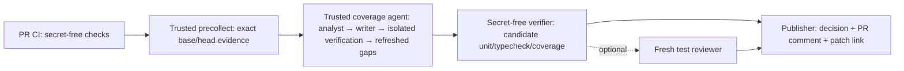

# Architektura Cloudfide unit test agent

Rewizja 2026-10-15. Sposób uruchomienia opisuje [SOLUTION.md](../SOLUTION.md); rzeczywiste lokalne wyniki i ograniczenia: [validation.md](validation.md).

GitHub Actions jest środowiskiem docelowym. Oddzielny pakiet agent/ zawiera mały kontroler TypeScript, dwa noninteractive CLI adapters i trzy własne role/skills. Nie zależy od osobistego Cortex/Vault ani ustawień tego komputera.

Kod i konfiguracja kontrolera pochodzą z control SHA default branch. PR dostarcza jedynie captured source/test data. Native runtime dostaje bounded inline bundle i zwraca structured data; nie dostaje checkoutu PR do wykonania. Host materializuje treści testów. coverage-gap wywołuje istniejący verifier w izolowanych kontenerach pomiędzy rundami; końcowy niezależny job verifier ponownie mierzy skumulowaną propozycję i pozostaje autorytatywny dla publikowanego celu.

| Moduł                                        | Właściciel granicy                                      |
| -------------------------------------------- | ------------------------------------------------------- |
| [Contracts](architecture/contracts.md)       | Context, cases, files, manifests i decyzje              |
| [Orchestrator](architecture/orchestrator.md) | Pojedynczy pr-change lub ograniczone rundy coverage-gap |
| [Providers](architecture/providers.md)       | Native launcher, capability conformance i cancellation  |
| [Budget](architecture/budget.md)             | Admission per call i uczciwa normalizacja kosztu        |
| [Verification](architecture/verification.md) | Patch allowlist, wykonanie i coverage                   |
| [GitHub](architecture/github.md)             | Metadata/provenance, secrets i publikacja               |

Rozszerzenia są małe: registry ProviderAdapter oraz QualityCheck.run. Obecne unit runners są stałe dla frontend/backend. Bez stage framework, własnego storage, query/cache engine lub recovery protocol. Optional checks dochodzą dopiero po działającym core.
